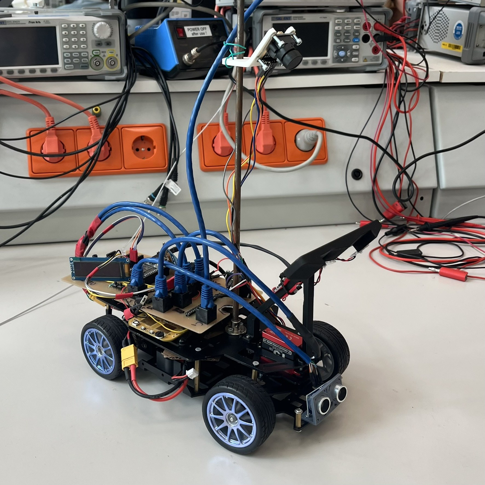

# NXP Cup Autonomous Car

Multi-board embedded firmware for a line-following car: S32K144 vehicle control,
Teensy 4.1 camera acquisition and perception, and ESP32 wireless tuning.
Includes board firmware, shared communication protocols, and Python camera
inspection tools.

**[Documentation](https://michalfrohlich.github.io/NXP-Cup-EXPO/)** |
[Build and test](#build-and-test) | [Mode reference](docs/system/modes.md)

  

**Demonstrations:** [Car driving](docs/assets/car-driving.mp4) |
[Python camera recorder](docs/assets/camera-recorder.mp4)

## System

| Board | Responsibilities | Stack |
|---|---|---|
| **S32K144** | Steering and dual ESC outputs, race/bench state machines, local camera, ultrasonic, fault handling | Bare-metal C, S32 Design Studio, NXP RTD/MCAL |
| **Teensy 4.1** | DMA-assisted line-camera acquisition, line detection, MPU6050 filtering, SPI telemetry | C++, Arduino/Teensy, PlatformIO |
| **ESP32** | Wi-Fi access point, embedded web tuning UI, UART command bridge, local display | C, ESP-IDF, PlatformIO |

S32K owns vehicle motion. Teensy supplies processed camera/IMU data over SPI;
ESP32 forwards user requests over UART. Available services depend on the
selected firmware mode. [Architecture](docs/system/README.md) |
[Mode and board combinations](docs/system/modes.md)

## Engineering Highlights

- **Camera acquisition:** Teensy FlexPWM, ADC triggering, and eDMA acquire pixels
  without a CPU callback per sample; foreground code publishes frames and runs vision.
- **Scheduled steering:** Teensy-camera race collects unique results across a
  20 ms servo period, fuses samples, and stages the steering command before its deadline.
- **Explicit communication contracts:** fixed 84-byte SPI v3 frames, CRC checks,
  sequence/freshness checks, and generation acknowledgment for detector settings.
- **Runtime tuning and diagnostics:** PID and vision parameters, mode-specific
  Start/Stop commands, hardware benches, LED/display status, and a Python viewer.

## Build And Test

| Target | Setup and build instructions |
|---|---|
| S32K144 | [S32DS/toolchain setup](firmware/s32k144/docs/build.md). On a fresh clone, import the project and generate `Debug_FLASH/` in S32DS before using the CLI make command. |
| Teensy 4.1 | [PlatformIO environments](firmware/teensy/README.md). Select a named environment for Race, Stack Drive, or a bench. |
| ESP32 | [Build, upload, and Wi-Fi connection](firmware/esp32/README.md). The ESP serves the webpage; no PC web server is needed. |
| Camera viewer | [Python setup and usage](tools/python/live_camera_viewer/README.md). Requires firmware with camera streaming enabled. |

Start with the [testing guide](docs/system/testing.md): verify local hardware,
then board links, then integrated driving. Support the chassis with wheels clear
for initial actuator tests.

## Status And Next Steps

Stack Drive supports ESP tuning and Start/Stop with S32K-camera steering;
Tune Drive supports ESP tuning with Teensy-camera steering. Standalone race
does not consume ESP commands. IMU data is telemetry-only, SD logging remains
a separate test, and runtime tuning is RAM-only.

Earlier integration runs completed camera-guided laps. The main open issue is
battery-powered SPI reliability: the USB-powered PCB communicated successfully,
while battery-powered tests showed signal noise and link failures.

Priorities are power/signal-integrity checks and PCB corrections, repeatable
full-car tests, vision/finish-line tuning, and SD latency measurements before
runtime logging integration. See [engineering findings](docs/system/findings.md)
for observations and recommendations.

## Documentation

- [Architecture and board responsibilities](docs/system/README.md)
- [Modes and board pairings](docs/system/modes.md)
- [Race scheduling](docs/firmware/s32k.md#camera-sources-and-timing)
- [LEDs, displays, and fault meanings](docs/system/status-led-semantics.md)
- [Tuning and command acknowledgment](docs/protocols/tuning.md)
- [Run the MkDocs site](docs/tooling/mkdocs.md)

Firmware lives in `firmware/`, portable protocols in `shared/`, host utilities
in `tools/`, and hardware references in `hardware/`. Vendor code retains its
original copyright and license notices.
