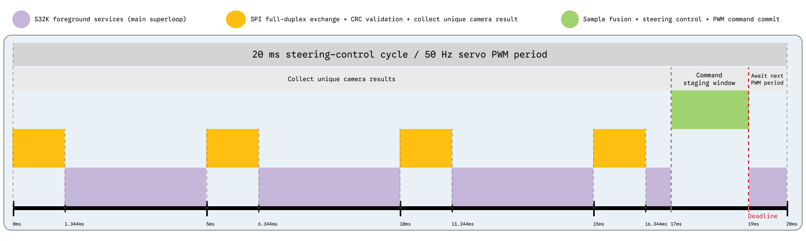

# S32K Application

The S32K is bare-metal C on NXP RTD/MCAL. Its app layer decides when the car
moves, where steering data comes from, and which faults stop it.

## Boot And Lifecycle

1. `main()` calls `App_RunBootBanner()`.
2. Common initialization brings up MCAL, cable UART, timebase, pot, and OLED.
   Generated timer/channel aliases come from `board_config.h`.
3. The selected build is printed to UART and displayed for three seconds while
   the RGB LED cycles.
4. `App_RunSelectedMode()` dispatches the one selected build flag.
5. A standalone mode owns its loop. The bench build owns a menu and calls the
   selected item's `enter -> update repeatedly -> exit` contract.

`Board_InitDrivers()` owns low-level bring-up. `App_InitRuntimeCore()` guards
one-time core initialization; `App_InitRuntimeCommon()` adds the display.
Mode entry initializes its camera, ESC, servo, ultrasonic, or link as needed.
The common service helper currently services the servo; it is not a global
dispatcher for every communication channel.

## Where To Find Behavior

| File under `firmware/s32k144/` | Owns |
|---|---|
| `src/app/app_modes.c` | Compile-time dispatch |
| `src/app/app_common.c` | Runtime tuning, profile adapters, boot, shared helpers |
| `src/app/app_internal.h` | Shared app contracts; dedicated state stays in its module |
| `src/app/modes/bench_menu.c` | Selection, switch guard, mode lifecycle, standalone camera/ESC wrappers |
| `src/app/modes/bench_tests.c` | Actuator/sensor benches and simple local-camera drive |
| `src/app/modes/mode_race.c` | Both race sources, Tune Drive, Stack Drive, speed policy and race faults |
| `src/app/modes/bench_serial_tune.c` | Cable tuning terminal/OLED UI |
| `src/app/modes/mode_esp_link.c`, `bench_esp_link.c` | ESP tests and tune/command consumption helpers |
| `src/app/modes/bench_teensy_link.c`, `mode_teensy_link.c` | SPI diagnostics and standalone wrapper |
| `src/services/steering_controller.c` | Steering calculation and explicit config/update/reset API |
| `src/app/vision_debug.c` | Local camera debug screens |

## Race Phases And Speed Profiles

Standalone races share a launcher: pot selects `SUPERFAST`, `5050`, or `SLOW`;
SW2 confirms; SW2 on READY returns to selection; SW3 starts ESC arming.
Profiles include PID, integral clamp, steering clamp/filter/rate limit, and
base speed. Constants live in `app_config.h`.

After the three-second ESC arm interval, the app enters `SPEED_RUN`. An
accepted finish-line result with confidence at least 50 enters `HONOR_RUN`.
Ultrasonic is serviced in both phases; distance-based speed policy belongs to
Honor:

| Valid distance | Honor target with current constants |
|---|---:|
| Above 45 cm | 10% |
| Above 15 cm through 45 cm | 5% |
| Above 8 cm through 15 cm | 3% |
| 8 cm or nearer | 0% |

Honor centers steering within 45 cm. Invalid distance falls back to Honor base
speed, not a latched ultrasonic fault. Honor with a lost line targets zero.
A zero distance-based target does not itself enter `STOPPED`; Honor can resume
as distance changes.

`STOPPED` and `FAULT` are separate states. Stack Drive Stop immediately commands
neutral/center; Start from stopped/fault re-enters arming and resets controller
history. Standalone race and Tune Drive SW3 stop is processed by their control
schedule and uses the normal speed ramp toward zero. They have no web Start
handler; restart via reset or bench exit/re-entry as applicable.

## Camera Sources And Timing

The diagram shows the nominal schedule. Each SPI block represents 1.344 ms of
wire time for 84 bytes at 500 kHz, plus CRC validation and software overhead.
The green region marks the 17-19 ms command staging window. Foreground services
run between transfers; peripheral interrupts run independently.

For Teensy-camera race and Tune Drive, each servo PWM rising edge starts a
20 ms period. SPI slots are planned at 0/5/10/15 ms. Only unique camera
sequences count; stale/lost results are excluded. At phase 17 ms the app
confidence-weights eligible samples, rejects at most one large outlier, and
runs the steering controller with `dt=0.020 s`.

The servo stages one duty update during `17 <= phase < 19 ms`. Missed slots
are skipped; a missed control deadline holds the previous command. See
[SPI timing](../protocols/teensy-s32k-spi-test.md#deterministic-camera-race-mode).

S32K-camera race and Stack Drive consume the local camera and run control on
a 10 ms schedule with the default servo update policy. Stack Drive also
services SPI for diagnostics/configuration, without using remote samples for
steering. ESP parsing runs at several foreground service points; the UART ISR
only buffers bytes/error markers.

## Faults And Tuning

Race checks camera freshness, control progress, and servo PWM progress. Line
loss has a three-second grace before its latched stop and stays white;
hardware/timing faults are red and command neutral immediately. The first
fault reason is retained. See [diagnostics](../system/status-led-semantics.md)
for thresholds and the narrower behavior of individual benches.

Steering configuration goes through `SteeringController_ApplyConfig()`; app
code does not edit PID internals. Live gains preserve history; explicit reset
occurs when a new run needs it. Motor speed remains application policy.
[Tuning scope](../protocols/tuning.md#where-values-take-effect) lists which modes
consume RAM values.

## Source References

- [Detailed S32K architecture](https://github.com/michalfrohlich/NXP-Cup-EXPO/blob/main/firmware/s32k144/docs/architecture.md)
- [Build and S32DS notes](https://github.com/michalfrohlich/NXP-Cup-EXPO/blob/main/firmware/s32k144/docs/build.md)
- [Application configuration](https://github.com/michalfrohlich/NXP-Cup-EXPO/blob/main/firmware/s32k144/src/app/app_config.h)
- [Race implementation](https://github.com/michalfrohlich/NXP-Cup-EXPO/blob/main/firmware/s32k144/src/app/modes/mode_race.c)
