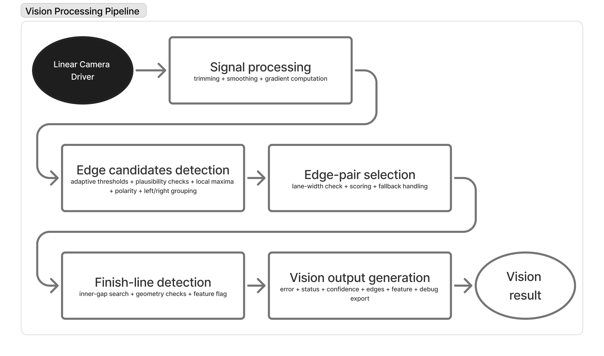

# Teensy Application

Teensy 4.1 runs Arduino setup/loop. The dispatcher selects a small mode wrapper;
Race, Link Bench, and Stack Drive reuse `TeensyRaceRuntime`. Camera Bench,
Hardware Test, and SD Test have their own loops.

## Shared Sensor Runtime

`TeensyRaceRuntime::begin()` sets up enabled diagnostics, camera 0, the MPU6050,
then the SPI slave. IMU initialization includes approximately two seconds of
stationary gyro calibration. SPI READY can therefore appear later than board
power-up; keep the car still through calibration.

The foreground service:

1. Services camera acquisition and processes completed frames.
2. Updates the tracking LED and optional Stack dashboard.
3. Emits an optional camera stream outside active readout.
4. Services SPI completion, validates/applies S32K detector settings, and
   prepares a telemetry frame.
5. Services scheduled sensor/telemetry publication and optional serial text.

Camera acquisition and telemetry target 200 Hz; the IMU sampling schedule is
configured for 100 Hz. Display/USB/I2C work shares the cooperative service loop
and can delay updates. Packet, camera, and sensor sequences identify
different events and need not match.

The current SPI slave is **software bit-banged**, not the earlier LPSPI/DMA
experiment. It blocks the foreground and masks interrupts during the clocked
transfer (about 1.344 ms of wire time at 500 kHz). Camera PWM/ADC/DMA hardware
continues, but foreground completion, USB, and interrupt delivery wait.
Camera DMA therefore does not make the whole Teensy application nonblocking.

## Camera And Vision

The diagram summarizes perception, not motor control. Acquisition and detector
processing are separate stages; S32K owns the subsequent vehicle commands.

The linear camera uses FlexPWM -> XBAR -> ADC_ETC -> ADC1 -> eDMA for pixel
acquisition. At 200 kHz, 129 readout clocks take about 645 microseconds. The
driver publishes 128 pixels; vision trims two pixels at each end to 124.
Foreground code handles completion, buffer publication, and line detection.
There is no CPU ADC callback for each pixel in this DMA path.

The foreground stops the pixel clock when it observes DMA completion. Late
service can extend the actual clock burst beyond the nominal 129 clocks;
capture duration/overrun counters and a scope are needed to verify it under
SPI/display load.

Camera 0 is active; camera 1 remains a stale/invalid telemetry slot. A running
ADC can capture a flat or floating input with no camera attached. Fresh frames
prove acquisition progress, not correct optics or sensor wiring.

Race, Link Bench, and Stack Drive accept SPI v3 camera-0 thresholds. Camera
Bench uses local defaults because it does not service SPI. Current defaults
are minimum contrast 650 ADC counts, high edge 40%, and low edge 55%.

## IMU And Logging

The MPU6050 driver performs real burst reads and gyro-bias calibration. It
integrates gyro rates and uses a complementary roll/pitch filter when the
acceleration norm supports gravity correction. Yaw is relative and drifts;
there is no magnetometer reference. Flags distinguish present, calibrated,
valid, and acceleration-trusted states.

IMU data is telemetry-only for current vehicle control. The integrated runtime
publishes logger flags as zero: **Race and Stack Drive do not log to SD yet**.
`teensy41-sdtest` exercises the standalone logger using synthetic pot/button
values, not real camera/IMU race recordings. It holds READY low and does not
require S32K. Hold button 2 for two seconds to close the file and check serial
status before removing power/card; arbitrary hot removal is not supported.

## Display And Debug Selection

| Mode | Expected output |
|---|---|
| Race | Tracking LED; no display, periodic text, or Python stream |
| Stack Drive | Tracking LED and SH1122 256x64 dashboard, nominally every 250 ms; button 2 toggles LED |
| Camera Bench | Tracking LED and binary USB camera/vision stream, nominally 100 Hz; optional display off |
| Link Bench | SPI/sensor runtime; flags currently enable binary stream and disable periodic text; tracking LED off |
| Hardware Test | Serial pin/button readings and manual RGB test |
| SD Test | Serial logger counters and logger-state RGB |

The optional Camera Bench display uses the separate **SSD1306 128x64 driver**.
It is not the Stack Drive SH1122 dashboard. Enabling that flag is not enough
to support SH1122 hardware in Camera Bench.

The Stack dashboard shows CAM0 track/error/confidence, SPI receive/error counts,
IMU `P/C/V/A`, last S32K app/state/speed/servo, configuration acknowledgment,
and LED enable state. Its `S32K:OK` is based on a stored valid snapshot, without
an age check in the renderer. Watch advancing counters rather than treating
that label as a heartbeat.

## Configuration And Source References

- [Build environments and pins](https://github.com/michalfrohlich/NXP-Cup-EXPO/blob/main/firmware/teensy/README.md)
- [Camera acquisition and viewer](https://github.com/michalfrohlich/NXP-Cup-EXPO/blob/main/firmware/teensy/docs/linear_camera_dma_bench.md)
- [MPU6050 calibration](https://github.com/michalfrohlich/NXP-Cup-EXPO/blob/main/firmware/teensy/docs/imu-mpu6050.md)
- [SD logging](https://github.com/michalfrohlich/NXP-Cup-EXPO/blob/main/firmware/teensy/docs/sd-logging.md)
- [Shared runtime](https://github.com/michalfrohlich/NXP-Cup-EXPO/blob/main/firmware/teensy/src/services/teensy_race_runtime.cpp)

See [modes](../system/modes.md#teensy-environments) for exact environments and
[testing](../system/testing.md) for upload/viewer commands.
