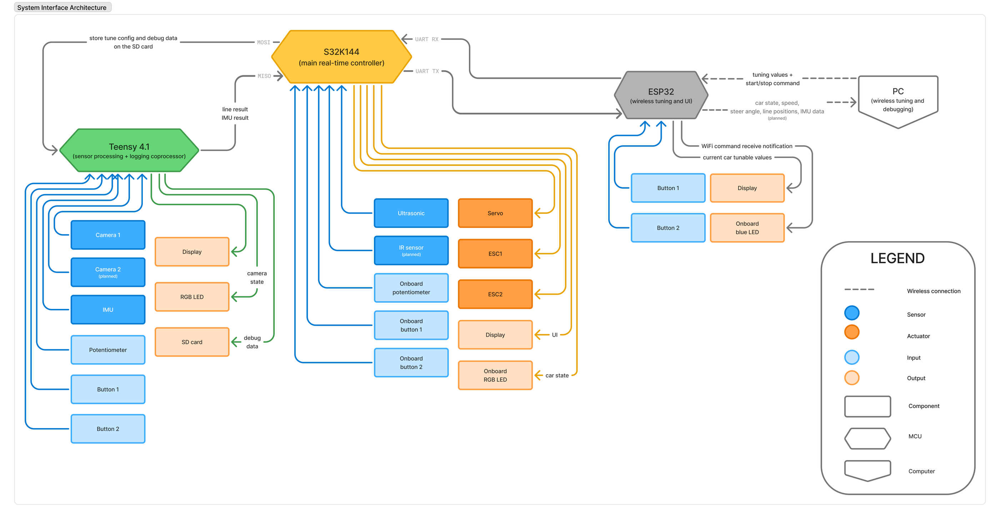
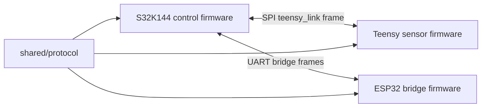

# NXP Cup Car Firmware

Engineering and bring-up guide for the three-board NXP Cup car. The S32K144
owns vehicle motion; the Teensy acquires and processes sensors; the ESP32
provides the wireless tuning interface.

[Architecture and implementation scope](system/README.md): board ownership,
interfaces, and active versus planned functions. Select the diagram for full resolution.

## Start Here

| Question | Read |
|---|---|
| What does each board own? | [Architecture and responsibilities](system/README.md) |
| Which firmware should be flashed together? | [Modes and board combinations](system/modes.md) |
| What does a color or display message mean? | [LEDs and displays](system/status-led-semantics.md) |
| How do we verify the car step by step? | [Testing guide](system/testing.md) |
| How do web settings reach the controller and camera? | [Tuning and drive commands](protocols/tuning.md) |
| What was learned, and what should be improved next? | [Engineering findings](system/findings.md) |

The mode tables describe available builds, not which binary is currently on a
board. Check the selected build flag/environment before flashing. The S32K
prints its selected build and shows a three-second boot banner.

## Main Areas

- S32K144 control firmware lives in `firmware/s32k144/`.
- Teensy firmware lives in `firmware/teensy/`.
- ESP32 firmware lives in `firmware/esp32/`.
- Shared cross-board packet contracts live in `shared/protocol/`.
- Hardware notes live in `hardware/`.

## Board Interaction

## Application Guides

- [S32K](firmware/s32k.md): boot, bench lifecycle, race phases, control timing,
  and configuration ownership.
- [Teensy](firmware/teensy.md): camera DMA, IMU, SPI publication, debug modes,
  and standalone SD logging.
- [ESP32](firmware/esp32.md): access point, embedded webpage, UART task, and OLED.

## Demonstrations

### Car Driving

<video controls preload="metadata" playsinline style="width:100%;max-width:360px" aria-label="Car driving demonstration">
  <source src="assets/car-driving.mp4" type="video/mp4">
  <a href="assets/car-driving.mp4">Download the driving demonstration</a>.
</video>

[Open driving video](assets/car-driving.mp4).

### Python Camera Recorder

<video controls preload="metadata" playsinline style="width:100%;max-width:800px" aria-label="Python camera recorder demonstration">
  <source src="assets/camera-recorder.mp4" type="video/mp4">
  <a href="assets/camera-recorder.mp4">Download the camera recorder demonstration</a>.
</video>

[Open recorder video](assets/camera-recorder.mp4). See the
[camera test procedure](system/testing.md) for firmware and viewer setup.
