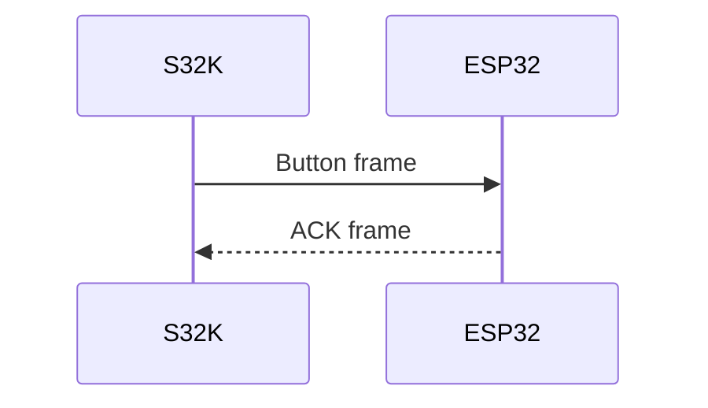

# MkDocs

MkDocs turns the Markdown files in `docs/` into a local engineering website.
The repository uses the Material theme and supports Mermaid diagrams inside
Markdown files.

## Public Site

[Open the documentation](https://michalfrohlich.github.io/NXP-Cup-EXPO/).
GitHub Pages serves the generated site, including images and demonstration
videos. Visitors need only a browser.

## Local Setup

Use Python 3.11 and run from the repository root. The documentation dependencies
are pinned in `requirements-docs.txt`.

Windows PowerShell:

```powershell
py -3.11 -m venv .venv
.\.venv\Scripts\python.exe -m pip install -r requirements-docs.txt
.\.venv\Scripts\python.exe -m mkdocs serve --dev-addr 127.0.0.1:8000
```

Linux/macOS:

```sh
python3.11 -m venv .venv
.venv/bin/python -m pip install -r requirements-docs.txt
.venv/bin/python -m mkdocs serve --dev-addr 127.0.0.1:8000
```

Open the URL printed by MkDocs. Keep the terminal open; Ctrl+C stops the
server. Source changes rebuild automatically. Use port 8001 if 8000 is occupied.

To build without serving, replace `serve --dev-addr 127.0.0.1:8000` with
`build --strict`. Output goes to `site/`; both `site/` and `.venv/` are ignored.

## GitHub Pages Deployment

One-time repository setup:

1. Open **Settings -> Pages -> Build and deployment**.
2. Set **Source** to **GitHub Actions**.
3. Merge the documentation and `.github/workflows/docs.yml` into `main`.
4. Check the **Documentation** workflow in the Actions tab.
5. Add the public site URL to the repository's **About -> Website** field.

The workflow builds every pull request targeting `main` with
`mkdocs build --strict`. Pushes to `main` build and deploy the site; pull
requests never deploy. **Actions -> Documentation -> Run workflow** can also
deploy manually when `main` is selected.

The build job has read-only repository access. Only the deployment job receives
Pages and OIDC write permissions, using the built-in GitHub token. No personal
access token, external hosting, generated-file commits, or `gh-pages` branch
is required. If the `github-pages` environment has branch restrictions, allow
deployments from `main`.

A failed build leaves the previously deployed site in place. For deployment
errors, check the workflow logs and Pages source setting. The public URL is
configured by `site_url` in `mkdocs.yml`.

## Site Organization

- `docs/system/`: responsibilities, mode combinations, indicators, test order.
- `docs/firmware/`: approachable board/application guides.
- `docs/protocols/`: wire contracts, tuning flow, link bring-up.
- `firmware/*/docs/`: detailed implementation notes retained beside firmware.

Only root `docs/` is rendered. Link to board-local implementation notes through
their GitHub source URLs from site pages; a relative `../../firmware/...` URL
escapes the published site and breaks. For a local checkout, those same notes
remain available on disk. Source links target `main`; uncommitted documentation
updates appear there only after integration.

## Adding Pages

1. Add a Markdown file under `docs/`.
2. Add the file to `mkdocs.yml` under `nav:`.
3. Run `mkdocs serve` to preview it.
4. Run `mkdocs build --strict` before committing documentation changes.

Check behavior against mode entry/update functions, not just headers or older
README claims. Document available selections, not the current local S32K flag.
Keep expected hardware behavior separate from recorded test results.

## Mermaid Diagrams

Use Mermaid for simple architecture, sequence, and state diagrams:

````markdown

````

Keep diagrams factual. If hardware details or timing assumptions are unknown,
mark them as TODO instead of guessing.
